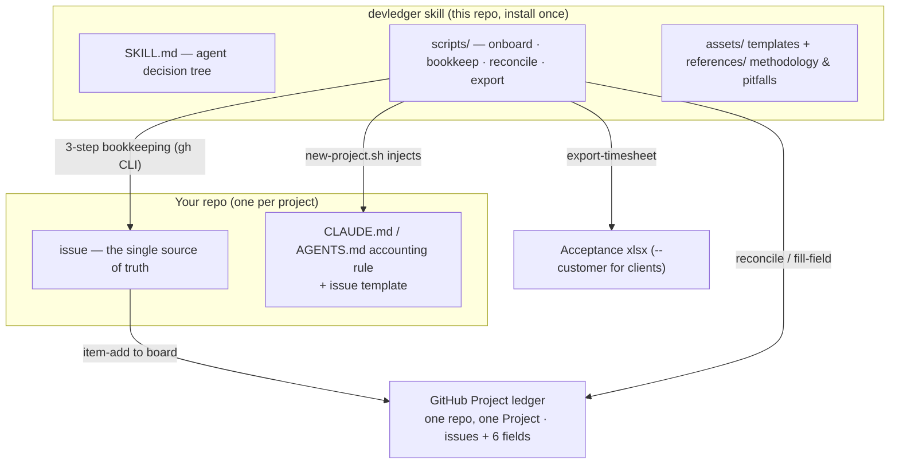
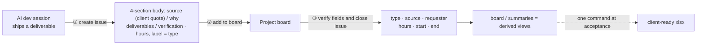

# devledger

English | [简体中文](README.zh-CN.md)

[](LICENSE)
[](https://github.com/guanlili/devledger/actions/workflows/ci.yml)
[](https://github.com/guanlili/devledger/releases)

**The self-writing ledger for R&D management.** If it's not bookkept, it didn't happen.

devledger is a lightweight, [Agent Skills](https://agentskills.io)-compliant skill that turns AI development sessions into an automatic issue + hours ledger on GitHub Projects. You talk to your AI; when the session ends, the work is already recorded — with type, source, dates, and human-equivalent hours. At acceptance time, export a client-ready timesheet with one command.

**Dogfooding**: devledger's own development is tracked by devledger — [see our live ledger](https://github.com/users/guanlili/projects/13).

## Built for the 1+N model

devledger is designed for the emerging way small teams ship: **one tech lead + a swarm of AI agents** — not for coordinating big human teams (that's Jira's problem, and we won't solve it).

```
Tech lead (you)           Agent sessions              devledger
──────────────            ─────────────               ─────────────
judgment: what & why  →   execution: how         →    the log: what happened
acceptance: good or not   self-reporting at          evidence · hours ·
                          session end (hard rule)    decision context
```

Four laws of this paradigm (our product constitution):

1. **Judgment is never delegated** — what/why/acceptance stay human; how is fully delegated
2. **Execution must self-report** — a session that didn't bookkeep equals work that didn't happen
3. **One source of truth** — issues are the ledger; boards and timesheets are derived views
4. **Hours are the metric** — human-equivalent hours measure whether a delegation was worth it

We think accounting for AI-assisted delivery is an open industry question. devledger aims to be a working reference practice for it — see [ROADMAP.md](ROADMAP.md).

## Why

- **Zero-input accounting**: no timesheets to fill, no boards to update. The AI records deliverables at session end — a hard rule, not a habit.
- **Evidence-first**: every ledger entry links real commits (`(#N)` convention) and verification results, with decision context captured while it's still fresh (why now, what alternatives were rejected).
- **Single source of truth**: issues are the ledger; Project fields and timesheets are derived views. Reconcile checks Project fields against a ledger file or delivery-round labels.
- **One repo, one project**: New Projects use the repository name. Repeat onboarding uses the Project number recorded in the repository.

## Quick start

**Install and check dependencies**

```bash
git clone https://github.com/guanlili/devledger.git ~/.agents/skills/devledger
bash ~/.agents/skills/devledger/scripts/install.sh
```

Run `install.sh` again to update. To try the workflow, run `bash ~/.agents/skills/devledger/scripts/demo.sh`. The demo creates a private sandbox repository, a Project, and a sample timesheet.

**Onboard a repository**

```bash
bash ~/.agents/skills/devledger/scripts/new-project.sh YOUR_OWNER/YOUR_REPO
```

Rerunning onboarding uses the recorded Project number and preserves its Status options and views. If an unconfigured repository has a matching Project name, verify the Project and rerun with `PM_RESUME=<number>`.

**Record work and export**

At session end, the agent creates or reuses an issue and runs [`bookkeep.py`](scripts/bookkeep.py). It reads back the Project fields before closing the issue. After an interruption, rerun with the same issue URL and arguments. See [scenario B in SKILL.md](SKILL.md).

```bash
python3 ~/.agents/skills/devledger/scripts/export-timesheet.py --project 123 --customer
```

Replace `123` with your Project number. `--customer` filters to client-requested items. If hours are missing, the workbook lists the affected issues and labels the total as recorded hours only.

## How it works

**Architecture** — repos hold docs, the skill holds actions, Projects hold data; the tool never ships into your delivery repo:



**The 3-step bookkeeping** — a hard rule at every AI session end, zero human input:



Requires `gh` with Project access, Git, Bash 3.2+, and Python 3. Onboarding requires `jq`, and exports require `openpyxl`. Works with ZCode, Claude Code, Cursor — any agent that reads SKILL.md/AGENTS.md.

## Documentation

- [SKILL.md](SKILL.md) — agent entry point (decision tree + per-scenario commands)
- [references/pitfalls.md](references/pitfalls.md) — gh/GitHub API pitfalls from real usage
- [references/methodology.md](references/methodology.md) — principles, data model, migration patterns
- [README.zh-CN.md](README.zh-CN.md) — full documentation in Chinese

## Support

- 🐛 Bugs: [open an issue](https://github.com/guanlili/devledger/issues/new?template=bug_report.md)
- 💡 Ideas: [feature request](https://github.com/guanlili/devledger/issues/new?template=feature_request.md)
- 💬 Q&A / usage: [GitHub Discussions](https://github.com/guanlili/devledger/discussions)（中英文均可）
- 🔒 Security: see [SECURITY.md](SECURITY.md)

## License

[MIT](LICENSE)
